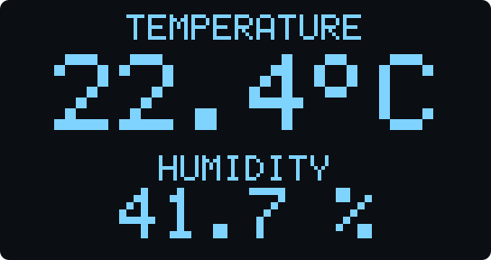
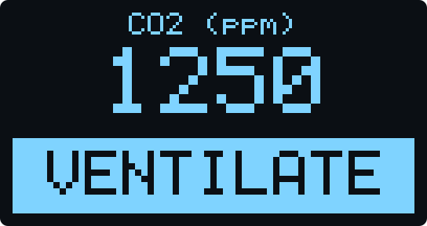
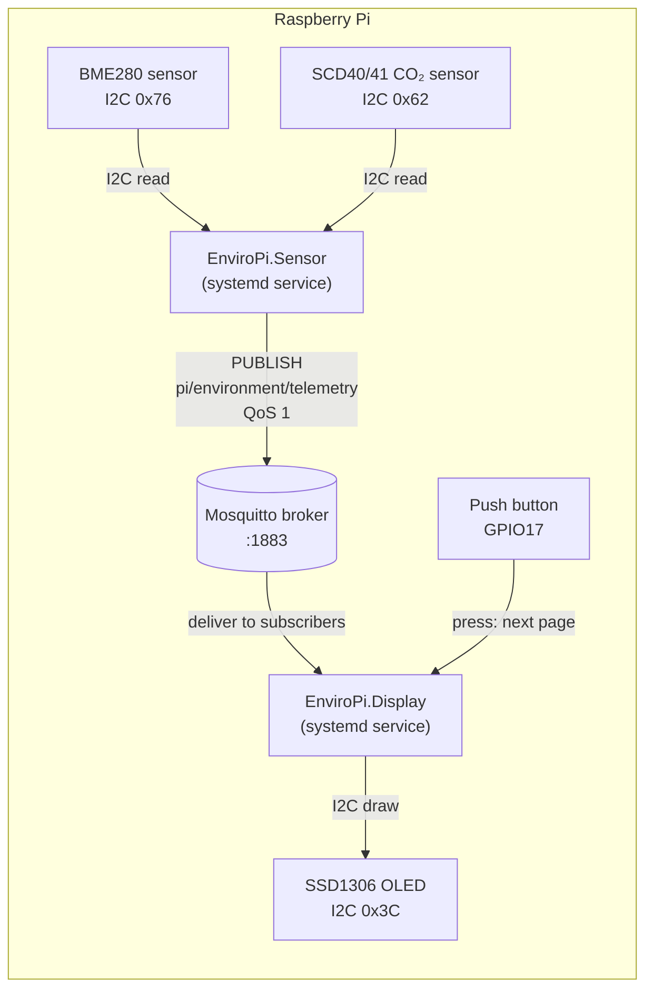
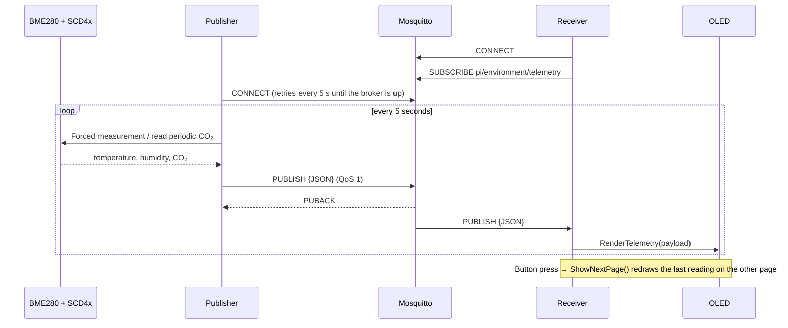
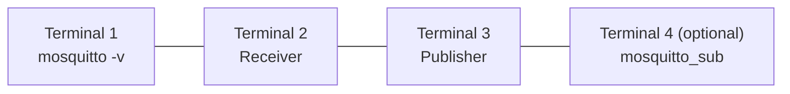
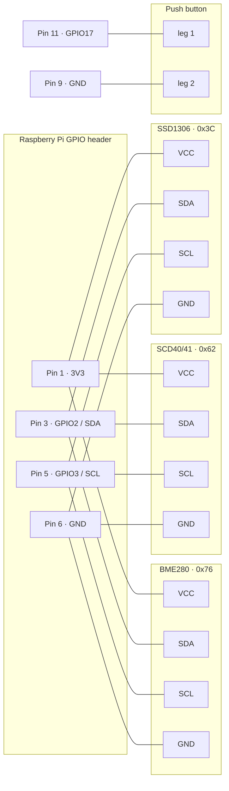
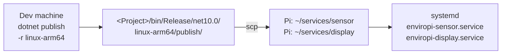

# EnviroPi: MQTT telemetry on Raspberry Pi with .NET

[](https://github.com/SabinMG/EnviroPi/actions/workflows/ci.yml)

[](LICENSE)

<p align="center">
  
  &nbsp;
  
  <br>
  <sub>The two OLED pages; a push button switches between them. Rendered from the real <code>TelemetryScreen</code> code.</sub>
</p>

A .NET 10 solution of two background services that talk to each other through an **MQTT broker (Mosquitto)**:

- **EnviroPi.Sensor** reads temperature and humidity from a **BME280** sensor and CO₂ from a **Sensirion SCD40/41** sensor, and publishes them as JSON every 5 seconds.
- **EnviroPi.Display** subscribes to those messages and shows them on an **SSD1306 OLED** display. A **push button** switches between a temperature/humidity page and a CO₂ page, which shows **VENTILATE** when CO₂ reaches 1000 ppm.

Both services also run on a normal computer with no hardware attached. The publisher then sends dummy temperature and humidity readings (20 °C, 50 %) with no CO₂ value, and the receiver only logs what it receives, so you can develop and test everything locally.

---

## Architecture



The publisher and receiver never connect to each other directly. Both connect to the broker, and the broker routes every message on the topic `pi/environment/telemetry` to everyone subscribed to it. You can therefore:

- run the publisher and receiver on **different devices**, as long as they use the same broker;
- add more subscribers (a dashboard, a logger, `mosquitto_sub`) without changing any code.

### Message flow



### Payload

Published on `pi/environment/telemetry`:

```json
{
  "DeviceId": "raspberrypi",
  "Timestamp": "2026-11-12T17:32:07.09122Z",
  "TemperatureCelsius": 21.4,
  "HumidityPercent": 48.2,
  "Co2Ppm": 812
}
```

`Co2Ppm` is `null` when no CO₂ sensor is connected or a reading fails. Messages from older publishers without the field still parse.

The same `TelemetryPayload` class (in `EnviroPi.Shared`) is used to write and read it, so both sides always agree on the format.

---

## Project layout

```text
EnviroPi-MQTT/
├── EnviroPi.sln
├── EnviroPi.Shared/                      # Class library used by both services
│   ├── Models/MqttOptions.cs             # Settings bound from appsettings.json
│   ├── Models/TelemetryPayload.cs        # JSON message shape
│   └── MqttConnection.cs                 # Connect-with-retry helper
├── EnviroPi.Sensor/                      # Sensor -> MQTT (publisher)
│   ├── Services/IMqttPublishService.cs   # Publishing abstraction injected into the worker
│   ├── Services/MqttPublishService.cs    # Owns the MQTT client: connect, retry, publish, disconnect
│   ├── Services/Sensors/Bme280ClimateSensor.cs  # BME280 temperature/humidity behind IClimateSensor
│   ├── Services/Sensors/Scd4xCo2Sensor.cs       # SCD40/41 CO₂ sensor behind ICo2Sensor
│   ├── Workers/SensorPublisherWorker.cs  # Reads the sensors, calls IMqttPublishService
│   ├── appsettings.json
│   └── Program.cs
├── EnviroPi.Display/                     # MQTT -> OLED (subscriber)
│   ├── Rendering/MonoBitmap.cs           # In-memory frame buffer (no SkiaSharp needed)
│   ├── Rendering/TextRenderer.cs         # Scaled 5x8 pixel-font text drawing
│   ├── Rendering/TelemetryScreen.cs      # Layout of the climate and CO₂ pages
│   ├── Models/DisplayOptions.cs          # Button GPIO pin, from appsettings.json
│   ├── Services/IDisplayService.cs       # Display abstraction injected into the workers
│   ├── Services/OledDisplayService.cs    # SSD1306 implementation; remembers page and last reading
│   ├── Workers/MqttReceiverWorker.cs     # Subscribes to the topic, calls IDisplayService
│   ├── Workers/ButtonWorker.cs           # Push button -> IDisplayService.ShowNextPage
│   ├── appsettings.json
│   └── Program.cs
├── EnviroPi.Tests/                       # xUnit tests (unit + end-to-end with in-process broker)
├── docs/                                # Screen previews used in this README
└── .github/workflows/ci.yml              # Build, test and publish linux-arm64 binaries
```

Main packages: `MQTTnet` 5.x, `Iot.Device.Bindings` 4.x, `System.Device.Gpio` 4.x, `Microsoft.Extensions.Hosting.Systemd`. Tests use `xUnit`, `NSubstitute` and `MQTTnet.Server`.

---

## 1. Prerequisites

| Where | What |
|---|---|
| Dev machine | [.NET 10 SDK](https://dotnet.microsoft.com/download) |
| Dev machine | Mosquitto, for local testing |
| Raspberry Pi | 64-bit Raspberry Pi OS. The .NET runtime is **not** needed (the builds are self-contained). |
| Raspberry Pi | Mosquitto, with I2C enabled |

---

## 2. Install Mosquitto

**macOS (Homebrew)**

```bash
brew install mosquitto
```

The broker is `/opt/homebrew/opt/mosquitto/sbin/mosquitto`. The client tools `mosquitto_pub` and `mosquitto_sub` are added to your PATH.

**Raspberry Pi / Debian / Ubuntu**

```bash
sudo apt update
sudo apt install -y mosquitto mosquitto-clients
sudo systemctl enable --now mosquitto
```

**Windows**: use the installer from <https://mosquitto.org/download/>.

### Allowing other devices to connect

Since version 2.0, Mosquitto with no config file **listens only on localhost**. That's fine when everything runs on one machine. If the publisher or receiver runs on a *different* device than the broker, add a listener:

```bash
sudo tee /etc/mosquitto/conf.d/enviropi.conf >/dev/null <<'EOF'
listener 1883
allow_anonymous true
EOF
sudo systemctl restart mosquitto
```

> `allow_anonymous true` lets anyone on your network publish and subscribe. That's fine on a home or lab network. For anything else, set up a password file (`mosquitto_passwd`) and turn anonymous access off.

---

## 3. Run locally (no hardware needed)



```bash
# Terminal 1 – start the broker with verbose logging
/opt/homebrew/opt/mosquitto/sbin/mosquitto -v      # macOS
# (on Linux, the broker is usually already running as a service)

# Terminal 2 – receiver
dotnet run --project EnviroPi.Display

# Terminal 3 – publisher
dotnet run --project EnviroPi.Sensor
```

Expected output: the publisher logs that it can't find the I2C sensors, then publishes dummy temperature and humidity every 5 seconds, with no CO₂ value.

```text
warn: SCD4x CO2 sensor not available (...). CO2 will not be published.
fail: Failed to connect to I2C sensor. Running with default dummy data.
info: Connected to MQTT broker at localhost:1883
info: Published to [pi/environment/telemetry]: {"DeviceId":"Mac","Timestamp":"...","TemperatureCelsius":20,"HumidityPercent":50,"Co2Ppm":null}
```

And the receiver:

```text
warn: OLED display not available (...). Telemetry will only be logged.
warn: Page button on GPIO17 not available (...).
info: Connected to localhost:1883 and subscribed to MQTT topic [pi/environment/telemetry]
info: Received MQTT payload: {"DeviceId":"Mac","Timestamp":"...","TemperatureCelsius":20,"HumidityPercent":50,"Co2Ppm":null}
```

You can start the services in any order. If the broker isn't running yet, they retry every 5 seconds.

---

## 4. Testing

### Automated tests

```bash
dotnet test
```

The tests need no hardware and no Mosquitto install, so they run the same on a laptop, on the Pi and in CI.

| Area | What is covered |
|---|---|
| `MqttConnection` | Connects first time, retries with attempt numbers, stops on cancellation |
| `TelemetryPayload` / `MqttOptions` | JSON round trip, the exact wire format, messages without `Co2Ppm` still parse, config binding, Sensor and Display `appsettings.json` agree on broker and topic |
| `Scd4xCo2Sensor` | Drives the real SCD4x driver through a fake I2C device that answers with CRC-checked Sensirion frames: start-up commands, ppm reading, missing sensor, bus failure during a read and on shutdown |
| `Bme280ClimateSensor` | Reports no reading when the BME280 is missing or the I2C bus fails |
| `SensorPublisherWorker` | Publishes rounded readings tagged with the machine name, with CO₂ when available; default values without a BME280; a failing sensor doesn't stop the other's values; shuts down cleanly |
| OLED rendering | Font drawing, scaling, clipping, the `°` glyph, culture-independent formatting, both pages, the inverted VENTILATE box at ≥ 1000 ppm, NO SENSOR placeholders, every value fits on screen |
| `OledDisplayService` | Drives the real SSD1306 driver through a fake I2C device and checks the 1,024 bytes sent match the rendered frame pixel for pixel; page switching redraws the last reading at once; waiting screen before the first reading |
| `ButtonWorker` | Each press switches page; configured GPIO pin; button released on shutdown; no GPIO or a failing display doesn't stop the service; pin read from `appsettings.json` (including `null` to disable) |
| End to end | Real publisher → in-process MQTT broker → real receiver → display, including CO₂; malformed messages are skipped |

Every push runs the tests on GitHub Actions and builds self-contained `linux-arm64` binaries for both services, which can be downloaded from the run's **Artifacts**.

### Manual testing with the Mosquitto CLI tools

The `mosquitto_sub` and `mosquitto_pub` tools are handy for checking each side on its own.

**Watch everything the publisher sends**

```bash
mosquitto_sub -h localhost -t 'pi/environment/telemetry' -v
```

**Watch every topic on the broker** (`#` is the multi-level wildcard)

```bash
mosquitto_sub -h localhost -t '#' -v
```

**Send a fake reading to the receiver**, without running the publisher:

```bash
mosquitto_pub -h localhost -t 'pi/environment/telemetry' -q 1 \
  -m '{"DeviceId":"manual","Timestamp":"2026-11-12T12:00:00Z","TemperatureCelsius":23.5,"HumidityPercent":41.0}'
```

The receiver should log `Received MQTT payload: ...`.

**Test error handling**: the receiver should log `Failed to parse incoming payload.` and keep running.

```bash
mosquitto_pub -h localhost -t 'pi/environment/telemetry' -m 'not json'
```

**Watch a broker on the Pi from your Mac**

```bash
mosquitto_sub -h raspberrypi.local -t 'pi/#' -v
```

---

## 5. Configuration

Each service reads the `MqttOptions` section of its `appsettings.json`:

```json
"MqttOptions": {
  "Server": "localhost",
  "Port": 1883,
  "ClientIdPrefix": "EnviroPiSensor",
  "Topic": "pi/environment/telemetry"
}
```

| Key | Meaning |
|---|---|
| `Server` | Broker host name or IP address. Use the Pi's address if the broker runs elsewhere. |
| `Port` | Broker port (1883 is standard MQTT without TLS). |
| `ClientIdPrefix` | The client ID prefix. The publisher appends the machine name; the receiver appends a random suffix. |
| `Topic` | Must be the **same** in both services. |

You can override any value with an environment variable, without editing the file (use a double underscore for nesting):

```bash
MqttOptions__Server=192.168.1.50 dotnet run --project EnviroPi.Sensor
```

The display service also reads a `Display` section:

```json
"Display": {
  "ButtonGpioPin": 17
}
```

| Key | Meaning |
|---|---|
| `ButtonGpioPin` | BCM GPIO number of the page button (default 17, header pin 11). Set it to `null` to turn the button off. |

---

## 6. Hardware wiring

The three I2C devices share **I2C bus 1** on the Pi. They have different addresses, so they can sit on the same two wires. The push button connects a GPIO pin to ground; the Pi's internal pull-up resistor is used, so no resistor is needed.



Enable I2C and check that all three devices are detected:

```bash
sudo raspi-config nonint do_i2c 0     # or: raspi-config → Interface Options → I2C
sudo apt install -y i2c-tools
i2cdetect -y 1                        # should show 3c, 62 and 76
```

> The SCD4x needs a few minutes after power-up to settle, and its automatic self-calibration assumes it sees fresh outdoor-level air (about 420 ppm) regularly. Readings are most accurate after it has run for about a week in a room that gets aired.

> Some BME280 boards use address `0x77`. If `i2cdetect` shows `77`, change `Bme280.DefaultI2cAddress` to `Bme280.SecondaryI2cAddress` in `Services/Sensors/Bme280ClimateSensor.cs`.

---

## 7. Build and deploy to the Raspberry Pi



**1. Build self-contained ARM64 binaries** on your dev machine:

```bash
dotnet publish EnviroPi.Sensor/EnviroPi.Sensor.csproj -c Release --runtime linux-arm64 --self-contained
dotnet publish EnviroPi.Display/EnviroPi.Display.csproj  -c Release --runtime linux-arm64 --self-contained
```

The output goes to each project's own folder:

- `EnviroPi.Sensor/bin/Release/net10.0/linux-arm64/publish/`
- `EnviroPi.Display/bin/Release/net10.0/linux-arm64/publish/`

**2. Copy them to the Pi:**

```bash
ssh pi@raspberrypi.local 'mkdir -p ~/services/sensor ~/services/display'
scp -r EnviroPi.Sensor/bin/Release/net10.0/linux-arm64/publish/* pi@raspberrypi.local:~/services/sensor/
scp -r EnviroPi.Display/bin/Release/net10.0/linux-arm64/publish/*  pi@raspberrypi.local:~/services/display/
ssh pi@raspberrypi.local 'chmod +x ~/services/sensor/EnviroPi.Sensor ~/services/display/EnviroPi.Display'
```

**3. Create the systemd services** on the Pi.

`/etc/systemd/system/enviropi-sensor.service`:

```ini
[Unit]
Description=EnviroPi Sensor (MQTT publisher)
After=network.target mosquitto.service

[Service]
WorkingDirectory=/home/pi/services/sensor
ExecStart=/home/pi/services/sensor/EnviroPi.Sensor
Restart=always
RestartSec=5
User=pi

[Install]
WantedBy=multi-user.target
```

`/etc/systemd/system/enviropi-display.service`:

```ini
[Unit]
Description=EnviroPi Display (MQTT subscriber)
After=network.target mosquitto.service

[Service]
WorkingDirectory=/home/pi/services/display
ExecStart=/home/pi/services/display/EnviroPi.Display
Restart=always
RestartSec=5
User=pi

[Install]
WantedBy=multi-user.target
```

The `pi` user must be in the `i2c` group to open `/dev/i2c-1`, and in the `gpio` group for the button. Both are the default on Raspberry Pi OS; otherwise run `sudo usermod -aG i2c,gpio pi`.

**4. Enable and start the services:**

```bash
sudo systemctl daemon-reload
sudo systemctl enable --now enviropi-sensor.service enviropi-display.service
```

**5. Watch the logs:**

```bash
journalctl -u enviropi-sensor -f
journalctl -u enviropi-display -f
```

---

## Design decisions

- **MQTT between the services, not direct calls.** The sensor and display don't know about each other. Either side can restart, move to another device or gain extra subscribers (a logger, a dashboard) without code changes, and the broker handles delivery.
- **QoS 1 (at least once).** A missed reading is harmless but cheap to avoid. Each reading replaces the last one, so an occasional duplicate is fine and exactly-once (QoS 2) isn't worth its extra round trips.
- **A shared contract library.** `TelemetryPayload` and `MqttOptions` live in `EnviroPi.Shared`, so the publisher and subscriber can't drift apart. A test also pins the exact JSON field names.
- **Degrade, don't crash.** With no sensor, the publisher sends dummy data. With no screen, the display only logs. With no broker, both retry every 5 seconds. Services can start in any order and run on a laptop with no hardware.
- **Hardware behind interfaces.** Workers depend on `IMqttPublishService`, `IClimateSensor`, `ICo2Sensor` and `IDisplayService`, so they can be tested with fakes. The sensor and OLED services accept an I2C device factory, so tests run the real drivers against a fake bus.
- **No SkiaSharp for the OLED.** `Iot.Device.Bindings` normally renders text through SkiaSharp, which ships large native libraries. A 1-bit 128×64 screen only needs to set pixels, so `MonoBitmap` and `TextRenderer` do that with the font already built into the library.
- **A workaround for a driver bug.** `Ssd1306` in `Iot.Device.Bindings` 4.2 always initialises the panel as 128×32 and draws only the top 32 rows. `OledDisplayService` sends the 64-row multiplex and COM-pin settings itself and writes the full frame. The fix is covered by a test.
- **No fake CO₂ value.** Without a BME280 the publisher sends dummy temperature and humidity so the pipeline can be tested, but a made-up CO₂ number could be mistaken for a real air-quality reading. `Co2Ppm` is `null` instead, and the display shows `---` / NO SENSOR.
- **A button for pages instead of cramming the screen.** Three readings don't fit legibly on 128×64 pixels. The display remembers the last reading, so a press redraws the other page at once instead of waiting up to 5 s for the next message. The `VENTILATE` box is inverted so it can be read from across a room.
- **systemd with self-contained builds.** The Pi doesn't need the .NET runtime installed. `AddSystemd()` reports start-up and shutdown to systemd, and `Restart=always` covers crashes.

---

## Troubleshooting

| Symptom | Likely cause / fix |
|---|---|
| `MQTT connect attempt N failed: ... refused` | The broker isn't running, or isn't reachable on that host and port. Check with `mosquitto_sub -h <host> -t '#'`. From another device, see [Allowing other devices to connect](#allowing-other-devices-to-connect). |
| Publisher sends 20 / 50 on the Pi | The sensor wasn't found. Check the wiring and run `i2cdetect -y 1`. The address may be `0x77`. |
| `Can not open I2C device file '/dev/i2c-1'` on the Pi | I2C is disabled, or the user isn't in the `i2c` group. |
| Receiver connects but logs nothing | The `Topic` is different in the two `appsettings.json` files, or they point to different brokers. |
| CO₂ page shows `---` / NO SENSOR | The SCD4x wasn't found when the sensor service started. Check `i2cdetect -y 1` shows `62`, then restart `enviropi-sensor`. |
| The button does nothing | Check the wiring (GPIO17 = pin 11, GND = pin 9) and `Display:ButtonGpioPin`. The display log says `Page button ready on GPIO17` when it is working. The user must be in the `gpio` group. |
| Two publishers kick each other off the broker | Both use the same client ID (same `ClientIdPrefix` and the same machine name). Change one prefix. |

---

## Known limitations

- The OLED rendering and the SCD4x driver are checked by tests against the drivers' I2C traffic, and the button with a simulated press, but none of them has been checked on physical hardware yet.
- The BME280 and SCD4x I2C addresses, the publish interval (5 s) and the 1000 ppm VENTILATE threshold are fixed in code rather than read from `appsettings.json`.
- The SCD4x isn't given the BME280's air pressure for compensation (`SetPressureCalibration`), so CO₂ is slightly less accurate far from sea level.
- The broker connection is plain MQTT on port 1883 with no TLS or authentication.

---

## License

Released under the [MIT License](LICENSE).
