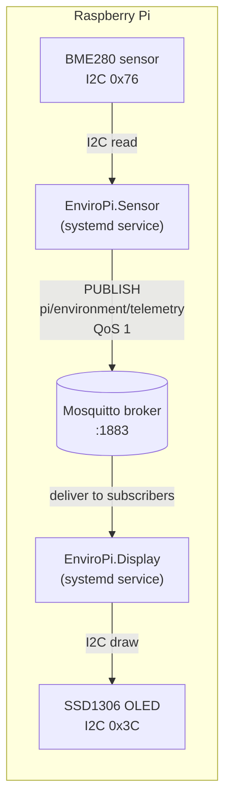
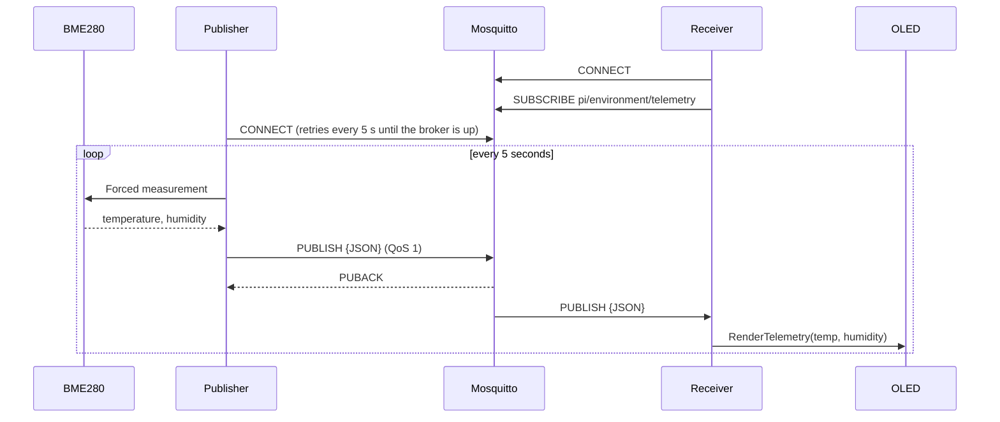
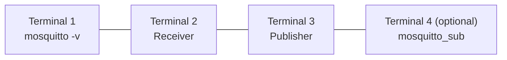
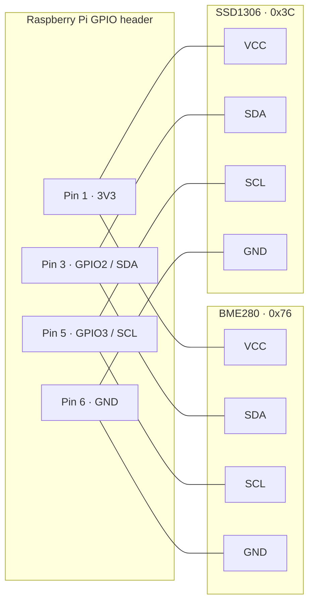
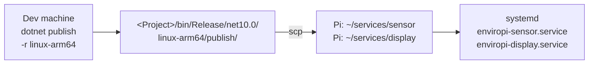

# EnviroPi: MQTT telemetry on Raspberry Pi with .NET

A .NET 10 solution of two background services that talk to each other through an **MQTT broker (Mosquitto)**:

- **EnviroPi.Sensor** reads temperature and humidity from a **BME280** sensor and publishes them as JSON every 5 seconds.
- **EnviroPi.Display** subscribes to those messages and sends them to an **SSD1306 OLED** display.

Both services also run on a normal computer with no hardware attached. The publisher then sends dummy readings (20 °C, 50 %) and the receiver only logs what it receives, so you can develop and test everything locally.

---

## Architecture



The publisher and receiver never connect to each other directly. Both connect to the broker, and the broker routes every message on the topic `pi/environment/telemetry` to everyone subscribed to it. You can therefore:

- run the publisher and receiver on **different devices**, as long as they use the same broker;
- add more subscribers (a dashboard, a logger, `mosquitto_sub`) without changing any code.

### Message flow



### Payload

Published on `pi/environment/telemetry`:

```json
{
  "DeviceId": "raspberrypi",
  "Timestamp": "2026-11-12T17:32:07.09122Z",
  "TemperatureCelsius": 21.4,
  "HumidityPercent": 48.2
}
```

The same `TelemetryPayload` class (in `EnviroPi.Shared`) is used to write and read it, so both sides always agree on the format.

---

## Project layout

```text
MQTTnet-Pi/
├── EnviroPi.sln
├── EnviroPi.Shared/                      # Class library used by both services
│   ├── Models/MqttOptions.cs             # Settings bound from appsettings.json
│   ├── Models/TelemetryPayload.cs        # JSON message shape
│   └── MqttConnection.cs                 # Connect-with-retry helper
├── EnviroPi.Sensor/                      # Sensor -> MQTT (publisher)
│   ├── Services/IMqttPublishService.cs   # Publishing abstraction injected into the worker
│   ├── Services/MqttPublishService.cs    # Owns the MQTT client: connect, retry, publish, disconnect
│   ├── Workers/SensorPublisherWorker.cs  # Reads the sensor, calls IMqttPublishService
│   ├── appsettings.json
│   └── Program.cs
├── EnviroPi.Display/                     # MQTT -> OLED (subscriber)
│   ├── Services/IDisplayService.cs       # Display abstraction injected into the worker
│   ├── Services/OledDisplayService.cs    # SSD1306 implementation of IDisplayService
│   ├── Workers/MqttReceiverWorker.cs     # Subscribes to the topic, calls IDisplayService
│   ├── appsettings.json
│   └── Program.cs
└── net_iot_mono_repo_architecture_guide.md
```

Main packages: `MQTTnet` 5.x, `Iot.Device.Bindings` 4.x, `System.Device.Gpio` 4.x, `Microsoft.Extensions.Hosting.Systemd`.

---

## 1. Prerequisites

| Where | What |
|---|---|
| Dev machine | [.NET 10 SDK](https://dotnet.microsoft.com/download) |
| Dev machine | Mosquitto, for local testing |
| Raspberry Pi | 64-bit Raspberry Pi OS. The .NET runtime is **not** needed (the builds are self-contained). |
| Raspberry Pi | Mosquitto, with I2C enabled |

---

## 2. Install Mosquitto

**macOS (Homebrew)**

```bash
brew install mosquitto
```

The broker is `/opt/homebrew/opt/mosquitto/sbin/mosquitto`. The client tools `mosquitto_pub` and `mosquitto_sub` are added to your PATH.

**Raspberry Pi / Debian / Ubuntu**

```bash
sudo apt update
sudo apt install -y mosquitto mosquitto-clients
sudo systemctl enable --now mosquitto
```

**Windows**: use the installer from <https://mosquitto.org/download/>.

### Allowing other devices to connect

Since version 2.0, Mosquitto with no config file **listens only on localhost**. That's fine when everything runs on one machine. If the publisher or receiver runs on a *different* device than the broker, add a listener:

```bash
sudo tee /etc/mosquitto/conf.d/enviropi.conf >/dev/null <<'EOF'
listener 1883
allow_anonymous true
EOF
sudo systemctl restart mosquitto
```

> `allow_anonymous true` lets anyone on your network publish and subscribe. That's fine on a home or lab network. For anything else, set up a password file (`mosquitto_passwd`) and turn anonymous access off.

---

## 3. Run locally (no hardware needed)



```bash
# Terminal 1 – start the broker with verbose logging
/opt/homebrew/opt/mosquitto/sbin/mosquitto -v      # macOS
# (on Linux, the broker is usually already running as a service)

# Terminal 2 – receiver
dotnet run --project EnviroPi.Display

# Terminal 3 – publisher
dotnet run --project EnviroPi.Sensor
```

Expected output: the publisher logs that it can't find the I2C sensor, then publishes dummy data every 5 seconds.

```text
fail: Failed to connect to I2C sensor. Running with default dummy data.
info: Publisher connected to MQTT Broker at localhost:1883
info: Published telemetry: {"DeviceId":"Mac","Timestamp":"...","TemperatureCelsius":20,"HumidityPercent":50}
```

And the receiver:

```text
warn: OLED display not available (...). Telemetry will only be logged.
info: Connected to localhost:1883 and subscribed to MQTT topic [pi/environment/telemetry]
info: Received MQTT payload: {"DeviceId":"Mac","Timestamp":"...","TemperatureCelsius":20,"HumidityPercent":50}
```

You can start the services in any order. If the broker isn't running yet, they retry every 5 seconds.

---

## 4. Testing with the Mosquitto CLI tools

The `mosquitto_sub` and `mosquitto_pub` tools are handy for checking each side on its own.

**Watch everything the publisher sends**

```bash
mosquitto_sub -h localhost -t 'pi/environment/telemetry' -v
```

**Watch every topic on the broker** (`#` is the multi-level wildcard)

```bash
mosquitto_sub -h localhost -t '#' -v
```

**Send a fake reading to the receiver**, without running the publisher:

```bash
mosquitto_pub -h localhost -t 'pi/environment/telemetry' -q 1 \
  -m '{"DeviceId":"manual","Timestamp":"2026-11-12T12:00:00Z","TemperatureCelsius":23.5,"HumidityPercent":41.0}'
```

The receiver should log `Received MQTT payload: ...`.

**Test error handling**: the receiver should log `Failed to parse incoming payload.` and keep running.

```bash
mosquitto_pub -h localhost -t 'pi/environment/telemetry' -m 'not json'
```

**Watch a broker on the Pi from your Mac**

```bash
mosquitto_sub -h raspberrypi.local -t 'pi/#' -v
```

---

## 5. Configuration

Each service reads the `MqttOptions` section of its `appsettings.json`:

```json
"MqttOptions": {
  "Server": "localhost",
  "Port": 1883,
  "ClientIdPrefix": "EnviroPiSensor",
  "Topic": "pi/environment/telemetry"
}
```

| Key | Meaning |
|---|---|
| `Server` | Broker host name or IP address. Use the Pi's address if the broker runs elsewhere. |
| `Port` | Broker port (1883 is standard MQTT without TLS). |
| `ClientIdPrefix` | The client ID prefix. The publisher appends the machine name; the receiver appends a random suffix. |
| `Topic` | Must be the **same** in both services. |

You can override any value with an environment variable, without editing the file (use a double underscore for nesting):

```bash
MqttOptions__Server=192.168.1.50 dotnet run --project EnviroPi.Sensor
```

---

## 6. Hardware wiring

Both devices share **I2C bus 1** on the Pi. They have different addresses, so they can sit on the same two wires.



Enable I2C and check that both devices are detected:

```bash
sudo raspi-config nonint do_i2c 0     # or: raspi-config → Interface Options → I2C
sudo apt install -y i2c-tools
i2cdetect -y 1                        # should show 3c and 76
```

> Some BME280 boards use address `0x77`. If `i2cdetect` shows `77`, change `Bme280.DefaultI2cAddress` to `Bme280.SecondaryI2cAddress` in `SensorPublisherWorker.cs`.

---

## 7. Build and deploy to the Raspberry Pi



**1. Build self-contained ARM64 binaries** on your dev machine:

```bash
dotnet publish EnviroPi.Sensor/EnviroPi.Sensor.csproj -c Release --runtime linux-arm64 --self-contained
dotnet publish EnviroPi.Display/EnviroPi.Display.csproj  -c Release --runtime linux-arm64 --self-contained
```

The output goes to each project's own folder:

- `EnviroPi.Sensor/bin/Release/net10.0/linux-arm64/publish/`
- `EnviroPi.Display/bin/Release/net10.0/linux-arm64/publish/`

**2. Copy them to the Pi:**

```bash
ssh pi@raspberrypi.local 'mkdir -p ~/services/sensor ~/services/display'
scp -r EnviroPi.Sensor/bin/Release/net10.0/linux-arm64/publish/* pi@raspberrypi.local:~/services/sensor/
scp -r EnviroPi.Display/bin/Release/net10.0/linux-arm64/publish/*  pi@raspberrypi.local:~/services/display/
ssh pi@raspberrypi.local 'chmod +x ~/services/sensor/EnviroPi.Sensor ~/services/display/EnviroPi.Display'
```

**3. Create the systemd services** on the Pi.

`/etc/systemd/system/enviropi-sensor.service`:

```ini
[Unit]
Description=EnviroPi Sensor (MQTT publisher)
After=network.target mosquitto.service

[Service]
WorkingDirectory=/home/pi/services/sensor
ExecStart=/home/pi/services/sensor/EnviroPi.Sensor
Restart=always
RestartSec=5
User=pi

[Install]
WantedBy=multi-user.target
```

`/etc/systemd/system/enviropi-display.service`:

```ini
[Unit]
Description=EnviroPi Display (MQTT subscriber)
After=network.target mosquitto.service

[Service]
WorkingDirectory=/home/pi/services/display
ExecStart=/home/pi/services/display/EnviroPi.Display
Restart=always
RestartSec=5
User=pi

[Install]
WantedBy=multi-user.target
```

The `pi` user must be in the `i2c` group to open `/dev/i2c-1`. It is by default on Raspberry Pi OS; otherwise run `sudo usermod -aG i2c pi`.

**4. Enable and start the services:**

```bash
sudo systemctl daemon-reload
sudo systemctl enable --now enviropi-sensor.service enviropi-display.service
```

**5. Watch the logs:**

```bash
journalctl -u enviropi-sensor -f
journalctl -u enviropi-display -f
```

---

## Troubleshooting

| Symptom | Likely cause / fix |
|---|---|
| `MQTT connect attempt N failed: ... refused` | The broker isn't running, or isn't reachable on that host and port. Check with `mosquitto_sub -h <host> -t '#'`. From another device, see [Allowing other devices to connect](#allowing-other-devices-to-connect). |
| Publisher sends 20 / 50 on the Pi | The sensor wasn't found. Check the wiring and run `i2cdetect -y 1`. The address may be `0x77`. |
| `Can not open I2C device file '/dev/i2c-1'` on the Pi | I2C is disabled, or the user isn't in the `i2c` group. |
| Receiver connects but logs nothing | The `Topic` is different in the two `appsettings.json` files, or they point to different brokers. |
| Two publishers kick each other off the broker | Both use the same client ID (same `ClientIdPrefix` and the same machine name). Change one prefix. |

---

## Known limitations

- `OledDisplayService.RenderTelemetry` only clears the screen. Drawing the temperature and humidity text still needs to be added, for example with `Iot.Device.Graphics` and SkiaSharp.
- The broker connection is plain MQTT on port 1883 with no TLS or authentication.

---

## License

Released under the [MIT License](LICENSE).
